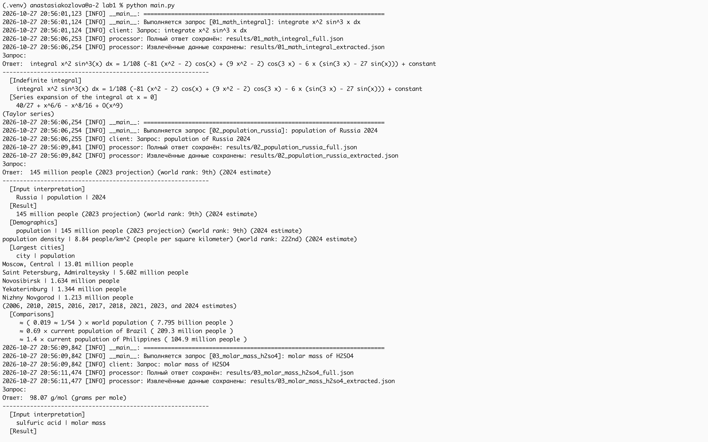

# Лабораторная работа №1. Интеграция Wolfram Alpha через API
## Описание:
Программа выполняет 15 запросов к Wolfram Alpha Full Results API,
извлекает ключевые данные из JSON-ответов и сохраняет результаты в файлы.

##Требования
- Python 3.10+
- Аккаунт Wolfram ID и AppID (https://developer.wolframalpha.com/)

##Установка
```bash
python3 -m venv .venv
```
    - установка виртуального окружения
```bash
python -m pip install requests
```
    - установка библиотеки requests в виртуальном окружении
   ```bash
   pip install -r requirements.txt
   ```
   - установка зависимости
   
##Запуск
1. запуск виртуального окружения (перед установкой библиотек, зависимотей и перед запуском программы)
```bash
source .venv/bin/activate
python main.py
```

## Запросы

Обязательные: интеграл, население России, молярная масса H2SO4, кинетическая энергия, расстояние Москва — Санкт-Петербург, курс USD/RUB, время в Казани, расстояние до Марса, ИМТ, перевод «hello» на русский.
Собственные ([QUIRIES]: 'main.py'): решение квадратного уравнения, скорость света в км/ч, скорость света, калорийность гречки, производная `sin(x)*e^x`.

##Результаты работы
```bash
├── app.log
├── results
│   ├── 01_math_integral_extracted.json
│   ├── 01_math_integral_full.json
│   ├── 02_population_russia_extracted.json
│   ├── 02_population_russia_full.json
│   ├── 03_molar_mass_h2so4_extracted.json
│   ├── 03_molar_mass_h2so4_full.json
│   ├── 04_kinetic_energy_extracted.json
│   ├── 04_kinetic_energy_full.json
│   ├── 05_distance_cities_extracted.json
│   ├── 05_distance_cities_full.json
│   ├── 06_currency_usd_rub_extracted.json
│   ├── 06_currency_usd_rub_full.json
│   ├── 07_time_kazan_extracted.json
│   ├── 07_time_kazan_full.json
│   ├── 08_distance_mars_extracted.json
│   ├── 08_distance_mars_full.json
│   ├── 09_bmi_extracted.json
│   ├── 09_bmi_full.json
│   ├── 10_translate_hello_extracted.json
│   ├── 10_translate_hello_full.json
│   ├── 11_ecuation_extracted.json
│   ├── 11_ecuation_full.json
│   ├── 12_physic_const_extracted.json
│   ├── 12_physic_const_full.json
│   ├── 13_speed_of_light_extracted.json
│   ├── 13_speed_of_light_full.json
│   ├── 14_diet_extracted.json
│   ├── 14_diet_full.json
│   ├── 15_math_analys_extracted.json
│   ├── 15_math_analys_full.json
│   └── report.txt
```
results/<name>_full.json — полный JSON-ответ API.
results/<name>_extracted.json — извлечённые данные.
results/report.txt — общий отчёт по всем запросам.
app.log — лог выполнения.

## Структура проекта
| Файл | Назначение |
|------|-----------|
| `main.py` | Точка входа, список запросов |
| `config.py` | загрузка конфигурации из JSON |
| `client.py` | клиент API с обработкой ошибок|
| `processor.py` | извлечение данных и сохранение |

## Пример вывода

